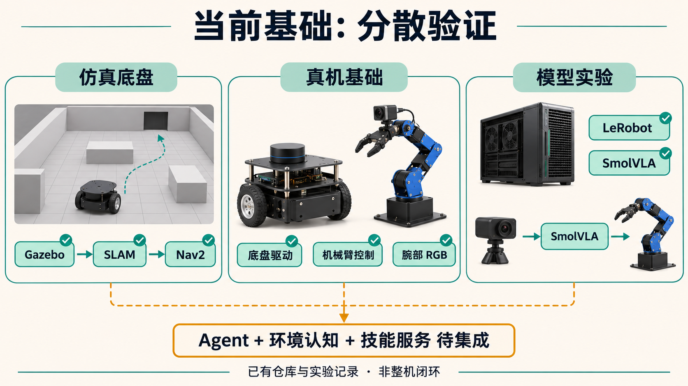
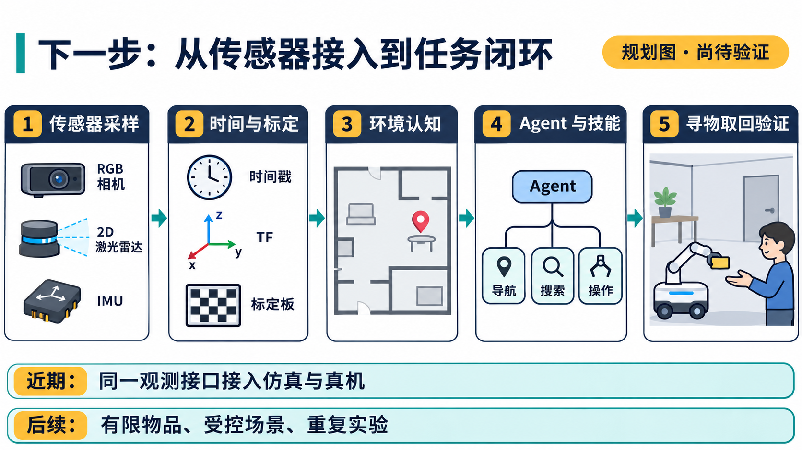

# Agent 驱动的可扩展具身家居机器人｜项目总站

本仓库是大创项目的**索引与进度入口**。现有代码分别保存在七个独立仓库；这里连接项目定义、已有实验、待集成模块和验证路线，不复制各仓库源码。

**首个验证问题：**在受控室内环境和有限物品集合中，让机器人依据环境信息寻找目标物品、完成取回，并记录可重复的实验结果。长期目标是让新传感器、技能和平台通过明确接口接入。当前各组件仍处于分散验证阶段，**整机任务闭环尚未完成**。

项目定义以 `da_chuang_20261112` 的当前维护文档为准；[GitHub 文档镜像](https://github.com/ianhequn/da_chuang_20261112) 的同步状态见 [工作区地图](docs/workspace-map.md)。本页是工程仓库入口，不替代申报书。

## 当前基础

> 图片为架构示意，表示已有独立实验及待集成关系，不是整机实拍或已完成闭环的证据。具体完成范围以各仓库的代码、记录和实验结果为准。

| 仓库 | 在项目中的位置 | 当前可核查内容 |
| --- | --- | --- |
| [da_chuang_20261112](https://github.com/ianhequn/da_chuang_20261112) | 项目定义、架构、申报与验证设计 | 项目说明、研究问题分解、架构设计、正文与阶段性工作稿；设计构想不能当作已实现功能 |
| [ChassisNav_01](https://github.com/ianhequn/ChassisNav_01) | 早期底盘导航仿真实验 | ROS 2/Gazebo/Nav2 相关实验；根 README 仍是占位内容，阅读时以代码和提交记录为准 |
| [ChassisNav_02_u22_wsl](https://github.com/ianhequn/ChassisNav_02_u22_wsl) | 当前自建底盘仿真基础 | 底盘 URDF、Gazebo、激光雷达、SLAM Toolbox 与 Nav2 配置和迭代记录 |
| [ros2_22_orangpi3b_261101](https://github.com/ianhequn/ros2_22_orangpi3b_261101) | 真机底盘接入 | 香橙派 3B 上的 ROS 2 底盘串口驱动、IMU/轮速数据与分阶段验证记录 |
| [ArmPi_Ultra_260913](https://github.com/ianhequn/ArmPi_Ultra_260913) | 机械臂与数据链路 | ROS 2 机械臂控制、关节反馈、LeRobot 数据流与真机回放；现有采集记录为单路 RGB，相机不经 ROS 2 接入 |
| [remote_SmolVLA](https://github.com/ianhequn/remote_SmolVLA) | 模型训练实验 | SmolVLA 数据检查、训练和环境验证脚本；其存在不代表模型已完成整机任务验证 |
| [robot_dev_note_261109](https://github.com/ianhequn/robot_dev_note_261109) | 环境与调试记录 | ROS 2、WSL 与香橙派环境搭建、设备配置笔记 |

这些仓库保留了各自的 Git 分支和提交历史。它们是**相关的独立工作区**，目前没有用 submodule 或单一构建命令组成一个可直接启动的整机系统。

## 下一步路线

近期先把常见传感器的**采样时间、接收时间、坐标系、标定参数、有效性和设备状态**整理成可检查的观测接口，并让仿真与真机数据通过同一接口进入上层。JSON 可描述接口和配置；原始图像、雷达扫描等数据继续由合适的数据通道承载。随后再接入环境认知、Agent 和导航/搜索/操作技能，以寻物取回任务验证协作效果。

具体阶段、验收点与未解决问题见 [实施路线](docs/roadmap.md)；当前证据边界见 [状态清单](docs/status.md)。本地目录、Git 仓库和阅读入口见 [工作区地图](docs/workspace-map.md)。

最近的代码审阅检查点见 [Codex 工程审阅注释（2026-11-28）](docs/codex-review-2026-11-28.md)；其中的建议尚未替代实机验证记录。

## 阅读顺序

1. 从 [项目定义](https://github.com/ianhequn/da_chuang_20261112) 理解目标、边界和研究问题。
2. 看 [仿真底盘](https://github.com/ianhequn/ChassisNav_02_u22_wsl) 与 [真机底盘](https://github.com/ianhequn/ros2_22_orangpi3b_261101)，对照传感器、坐标与导航接口。
3. 看 [机械臂链路](https://github.com/ianhequn/ArmPi_Ultra_260913) 与 [模型训练实验](https://github.com/ianhequn/remote_SmolVLA)，确认操作能力与数据流的实际范围。
4. 用 [开发笔记](https://github.com/ianhequn/robot_dev_note_261109) 追溯环境和调试过程，再回到本仓库跟踪集成进度。

## 更新约定

- 新增“已完成”状态时，链接到对应代码、运行记录或可重复实验结果。
- 将计划、候选方案和待验证问题明确标注，避免把设计图当作运行结果。
- 先保持七个源码仓库各自独立；跨仓库接口、阶段结果和集成说明在本站更新。
- 图片由图像生成模型制作，用于概览；技术细节以文字、代码和实验记录为准。
