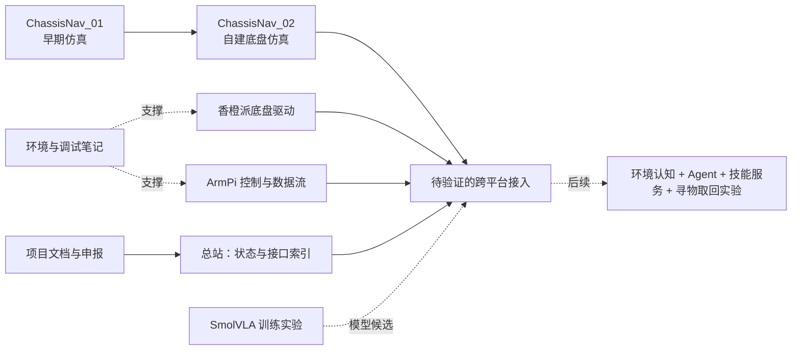

# 工作区地图

盘点时间：2026-11-19（北京时间）。范围：本机 `D:\大创`。这里记录**目录与仓库的实际关系**，不是新的项目目标或已经完成的整机能力。技术结论以对应源码和实验记录为准；项目定义以 `da_chuang_20261112` 的当前文档为准。

## 1. 顶层目录

```text
D:\大创\
├─ da_chuang_20261112\       项目定义、申报书与调研；独立 Git 仓库
├─ workplace\
│  ├─ ArmPi_Ultra_260913\    机械臂控制、LeRobot 数据流
│  ├─ ChassisNav_01\         早期底盘导航仿真
│  ├─ ChassisNav_02_u22_wsl\ 自建底盘 Gazebo/SLAM/Nav2 仿真
│  ├─ ros2_22_orangpi3b_261101\ 香橙派底盘驱动
│  ├─ remote_SmolVLA\        SmolVLA 训练脚本
│  └─ robot_dev_note_261109\ 环境、安装与调试笔记
├─ agent-home-robot-hub\     七个仓库的公开入口；独立 Git 仓库
└─ .github_migration\        2026-11-17 迁移时的临时镜像与脚本
```

顶层 `D:\大创` 和 `workplace` **没有共同的 `.git`**；上图共 8 个独立工作树。七个原仓库的本地 `origin` 指向 Codeup；总站的本地 `origin` 指向 GitHub。七个公开 GitHub 仓库是原历史的作者身份改写副本，提交 SHA 与 Codeup 不同。后续跨站同步需要按仓库处理，不能直接把 Codeup 分支推到 GitHub 覆盖。

## 2. 项目文档的阅读路径

`da_chuang_20261112` 的当前主线：

```text
项目说明.md（目标、问题、边界）
  → 研究问题分解.md（六项研究内容）
  → 架构设计.md（层级与接口）
  → 正文思路.md / 正文逻辑链条.md（申报论证）
  → 立项依据.md（正式正文）
```

辅助目录：`search/` 是调研、引用核查及候选技术路线；`ai_note/` 是设计和讨论工作稿；`ai_session_note/` 是会话记录；`old_docs/` 是旧稿；`资料/` 是学校模板与操作指南；`others/` 是团队记录和外部工具资料。**这些目录不等于新的运行模块。**

当前 `立项依据.md` 已包含第（1）至（6）节及参考文献；第（7）节“已有基础”只有两条待展开提纲。11 月 19 日的更新集中在正文研究内容第一项和会话记录；`参考项目_references.md` 及 `search/` 没有本轮新增修改。根目录 `README.md` 仍写着“第六、七节尚待编写”，阅读进度时应以正文为准。`others/SKILLS/` 存放大量外部工具资料，和机器人运行代码分开看。

`others/gdut-dachuang-guide` 与 `others/stardust-agent` 被 Git 记录为 gitlink，但仓库没有 `.gitmodules`，本地目录也没有可读内容。它们目前不能作为可直接复现的依赖入口；需补来源地址或移除失效引用后再引用。

## 3. 六个工程仓库

| 本地目录 / GitHub | 主要入口 | 已有基础 | 尚未由此仓库证明 |
| --- | --- | --- | --- |
| [ArmPi_Ultra_260913](https://github.com/ianhequn/ArmPi_Ultra_260913) | `My_note/README.md`；`src/arm_lerobot_dataset_stream/README.md` | ROS 2 Jazzy 机械臂控制、反馈、TCP/LeRobot 上下行；文档记录真机验证；`src/` 还包含 YDLidar ROS 2 驱动包 | RGB-D 接入、相机与底盘统一时空标定、整机抓取任务 |
| [ChassisNav_01](https://github.com/ianhequn/ChassisNav_01) | `src/chassis_sim/`、`src/chassis_bringup/` | 早期 Gazebo/Nav2 相关仿真实验 | 默认 `master` 与更新的 `main`/实验分支并非同一最新版本；根 README 仍是模板，不能当作可复现说明 |
| [ChassisNav_02_u22_wsl](https://github.com/ianhequn/ChassisNav_02_u22_wsl) | `src/dd_chassis_01_description/launch/`；`config/` | 自建差速底盘 URDF、Gazebo、雷达、IMU、SLAM Toolbox、Nav2 配置 | 没有根 README；真机驱动与仿真配置尚未在此仓库形成已验证的单一部署 |
| [ros2_22_orangpi3b_261101](https://github.com/ianhequn/ros2_22_orangpi3b_261101) | `src/DD_Chassis_001_driver/README.md`；`dev_note/` | ROS 2 Humble/香橙派底盘串口、轮速、IMU 与 ros2_control 实现；分级验证记录 | 该驱动包明确不含激光雷达；与仿真导航及机械臂的整机联调 |
| [remote_SmolVLA](https://github.com/ianhequn/remote_SmolVLA) | `README.md`；`scripts/` | HPC 上的数据检查、训练和冒烟测试脚本，面向单路 RGB 的 ArmPi 数据 | 模型训练脚本不等于真机任务成功率或 Agent 技能接入 |
| [robot_dev_note_261109](https://github.com/ianhequn/robot_dev_note_261109) | `ros2/`；`orangepi3b_u22`、`wsl_24` 分支 | WSL、香橙派与 ROS 2 环境记录 | 各分支笔记不是统一安装脚本；默认分支没有总览 README |

这些仓库覆盖不同运行环境：机械臂工作区记录 ROS 2 Jazzy，香橙派底盘驱动记录 ROS 2 Humble，另有 Windows/WSL 与 HPC 训练环境。应分别按仓库构建和运行，再用经过验证的消息与服务接口联调。

## 4. 当前工程关系



图中的“待验证”是实际工程缺口：传感器采样和时间基准、坐标/标定、数据新鲜度、仿真与真机接口、技能状态与失败反馈、环境认知、Agent 运行时，以及物理任务结果记录。当前仓库没有证据支持七者已共同完成寻物取回闭环。

## 5. 同步与维护注意点

- 截至本次盘点，项目文档本地、Codeup 与 GitHub 均已包含 **108 个提交**；GitHub 历史因统一作者身份而具有不同 SHA，但各阶段提交仍分别保留。11 月 19 日最新的正文和阶段记录已同步。
- 六个工程仓库的 Codeup 分支头与上次 GitHub 迁移时一致，本轮没有新的工程提交需要同步。
- 七个原工作树均无未提交修改；总站原 `main` 也无未提交修改。分支历史不能仅看当前检出的分支，例如 `ChassisNav_01` 的 `master` 停在 10 月，另有 11 月的 `main` 和实验分支。
- `.github_migration/` 约 43 MB，是上次 GitHub 历史迁移留下的临时镜像和脚本，不是机器人代码或第三方依赖；临时 SSH 部署密钥已撤销并删除。

## 6. 当前最有回报的下一步

1. **校准项目入口：**更新项目文档 README 对第（6）（7）节的状态说明，并处理两个缺少来源的 gitlink。
2. **补可运行说明：**先为 `ChassisNav_02_u22_wsl` 和真机底盘写清最小启动、话题、TF、时钟来源及验证命令；`ChassisNav_01` 标注为历史实验。
3. **做一个传感器适配闭环：**选同类仿真/真机输入，记录采样与到达时间、frame、单位、标定版本和新鲜度；先让上层通过同一接口读取，再接 Agent。
4. **逐项接技能和环境认知：**导航、观测搜索、机械臂操作分别提供状态/取消/失败反馈，随后用受控场景验证完整寻物取回。

完成每一步后，把运行命令、设备条件、失败案例与结果链接回本站。未实际测试的部分保留为计划。
